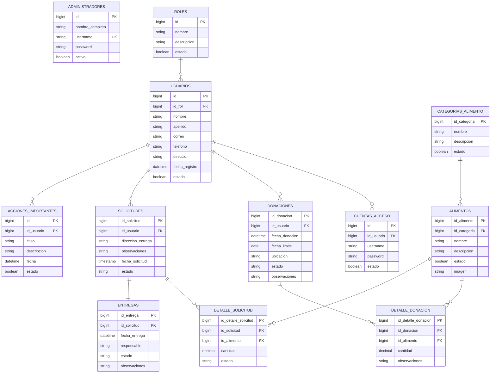
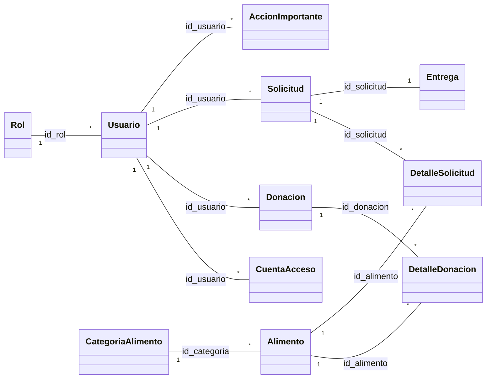
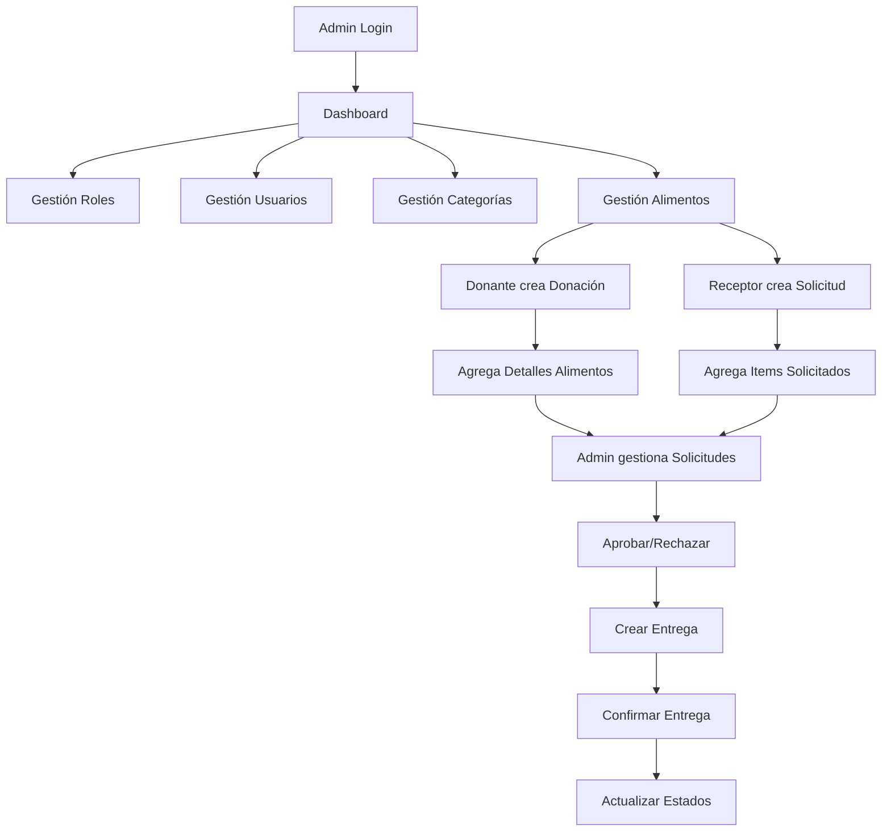

# ⚡ Diagramas de Referencia Rápida

## 🗄️ ER Diagram (Mermaid Live Editor compatible)



---

## 🔗 Relaciones Eloquent (Resumen)



---

## 🛣️ Rutas por Módulo (Patrón Unificado)

| Módulo | Prefijo | Rutas (9 c/u) |
|--------|---------|---------------|
| **Roles** | `/roles` | index, create, store, edit, update, show, trashed, destroy, restore, forceDestroy |
| **Usuarios** | `/usuarios` | index, create, store, edit, update, show, trashed, destroy, restore, forceDestroy |
| **Cuentas Acceso** | `/cuentas-acceso` | index, create, store, edit, update, show, trashed, destroy, restore, forceDestroy |
| **Categorías** | `/categorias` | index, create, store, edit, update, show, trashed, destroy, restore, forceDestroy |
| **Alimentos** | `/alimentos` | index, create, store, edit, update, show, trashed, destroy, restore, forceDestroy |
| **Donaciones** | `/donaciones` | index, create, store, edit, update, show, trashed, destroy, restore, forceDestroy |
| **Solicitudes** | `/solicitudes` | index, create, store, edit, update, show, trashed, destroy, restore, forceDestroy |
| **Entregas** | `/entregas` | index, create, store, edit, update, show, trashed, destroy, restore, forceDestroy |
| **Acciones Importantes** | `/acciones-importantes` | index, create, store, edit, update, show, trashed, destroy, restore, forceDestroy |

**Total: ~85 rutas** (todas protegidas con `auth:admin` excepto login)

---

## 📦 Estructura de Carpetas Clave

```
app/
├── Http/Controllers/     # 11 Controladores
│   ├── AuthAdminController.php
│   ├── RolController.php
│   ├── UsuarioController.php
│   ├── CuentaAccesoController.php
│   ├── CategoriaAlimentoController.php
│   ├── AlimentoController.php
│   ├── DonacionController.php
│   ├── SolicitudController.php
│   ├── EntregaController.php
│   └── AccionImportanteController.php
├── Models/               # 13 Modelos Eloquent
│   ├── Administrador.php
│   ├── Rol.php
│   ├── Usuario.php
│   ├── CuentaAcceso.php
│   ├── CategoriaAlimento.php
│   ├── Alimento.php
│   ├── Donacion.php
│   ├── DetalleDonacion.php
│   ├── Solicitud.php
│   ├── DetalleSolicitud.php
│   ├── Entrega.php
│   ├── AccionImportante.php
│   └── User.php
└── Providers/

database/migrations/      # 18 Migraciones
routes/
├── web.php              # 283 líneas - Todas las rutas web
└── console.php
```

---

## 🔄 Flujo de Datos Principal



---

## 🎯 Comandos Esenciales

```bash
# Desarrollo
php artisan serve                    # Servidor local
php artisan migrate                  # Ejecutar migraciones
php artisan migrate:fresh --seed     # Reset BD + seeders
php artisan route:list               # Ver todas las rutas
php artisan route:list --name=donaciones  # Filtrar rutas

# Código
./vendor/bin/pint                    # Formatear código (Pint)
php artisan test                     # Tests
php artisan make:model Nombre -mcr   # Modelo + Migración + Controller

# Cache
php artisan optimize:clear           # Limpiar todo cache
```

---

## 📊 Estados Principales

| Entidad | Estados |
|---------|---------|
| **Solicitud** | `pendiente` → `aprobada`/`rechazada` → `en_preparacion` → `en_ruta` → `entregada` |
| **Donación** | `disponible` → `reservada` → `entregada` / `expirada` |
| **Soft Delete** | `activo` → `eliminado` (trashed) → `restaurado` / `forzado` |

---

> **Tip:** Copia cualquier diagrama Mermaid y pégalo en [Mermaid Live Editor](https://mermaid.live/) para visualizarlo interactivamente.