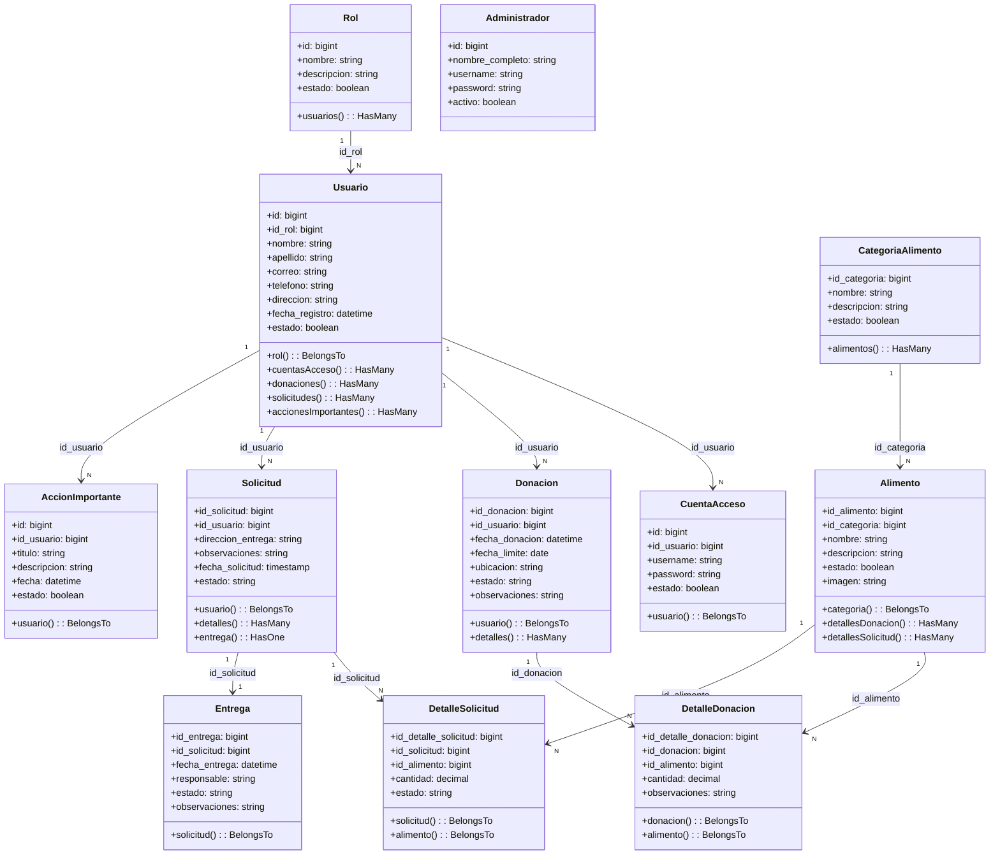
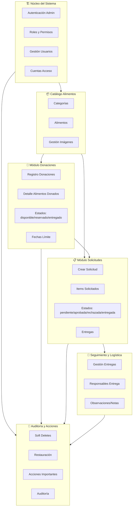
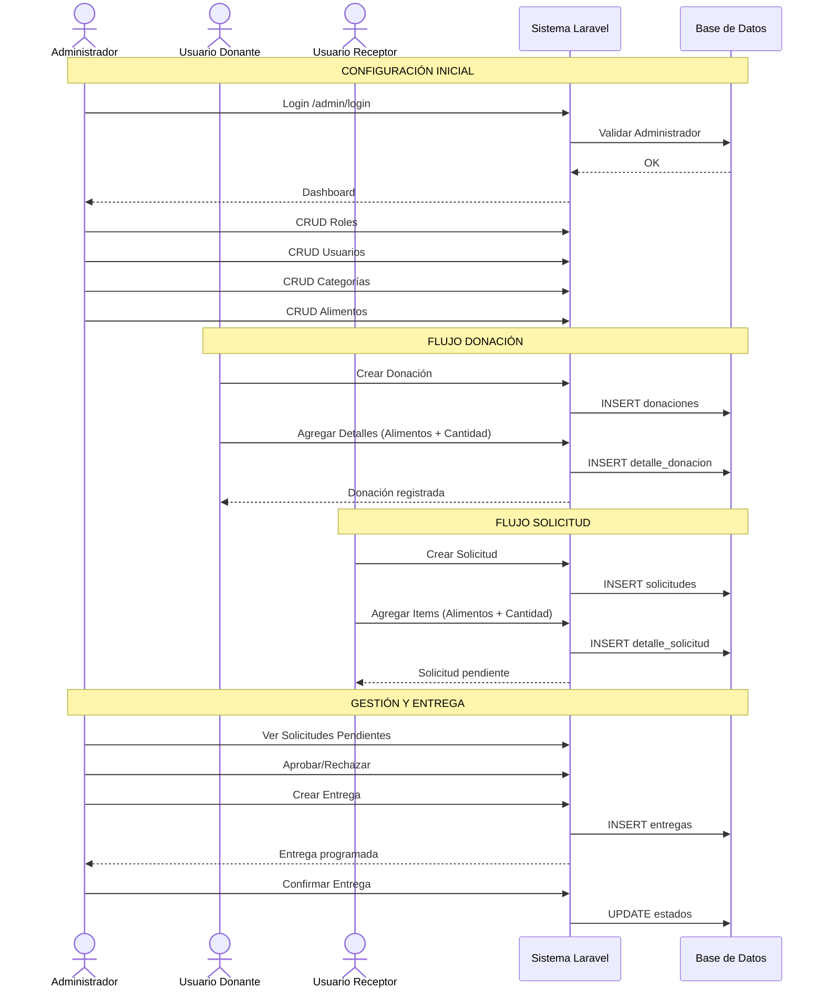
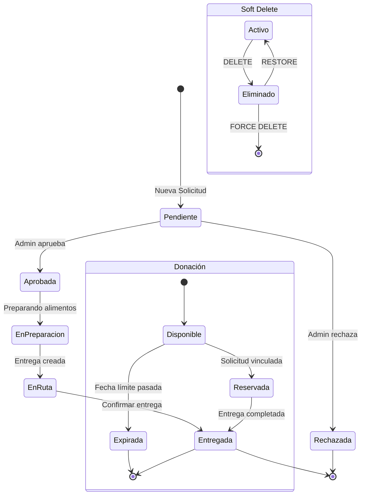
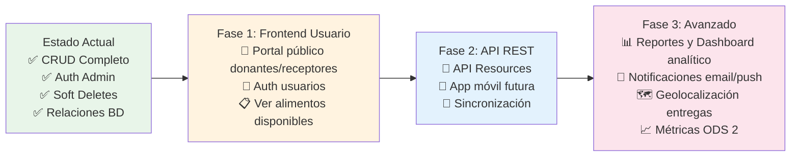

# 📋 Guía Visual del Proyecto: Redistribución de Alimentos Excedentes

> **Proyecto Laravel 11** — Alineado con **ODS 2: Hambre Cero**  
> Equipo: Rito Aguíla · Jorge Moreno · Cristobál Morales

---

## 1. 🏗️ Estructura de Directorios (Arquitectura Laravel)

```mermaid
graph TD
    ROOT[📁 Redistribucion_de_alimentos_excedentes]
    
    ROOT --> APP[📁 app/]
    ROOT --> BOOTSTRAP[📁 bootstrap/]
    ROOT --> CONFIG[📁 config/]
    ROOT --> DATABASE[📁 database/]
    ROOT --> PUBLIC[📁 public/]
    ROOT --> RESOURCES[📁 resources/]
    ROOT --> ROUTES[📁 routes/]
    ROOT --> STORAGE[📁 storage/]
    ROOT --> TESTS[📁 tests/]
    ROOT --> VENDOR[📁 vendor/]
    ROOT --> NODE[📁 node_modules/]
    
    APP --> APP_HTTP[📁 Http/]
    APP --> APP_MODELS[📁 Models/]
    APP --> APP_PROVIDERS[📁 Providers/]
    
    APP_HTTP --> CONTROLLERS[📁 Controllers/]
    CONTROLLERS --> AUTH[AuthAdminController]
    CONTROLLERS --> ROL[RolController]
    CONTROLLERS --> USUARIO[UsuarioController]
    CONTROLLERS --> CUENTA[CuentaAccesoController]
    CONTROLLERS --> CAT[CategoriaAlimentoController]
    CONTROLLERS --> ALIMENTO[AlimentoController]
    CONTROLLERS --> DONACION[DonacionController]
    CONTROLLERS --> SOLICITUD[SolicitudController]
    CONTROLLERS --> ENTREGA[EntregaController]
    CONTROLLERS --> ACCION[AccionImportanteController]
    
    APP_MODELS --> MODELS_LIST[13 Modelos Eloquent]
    MODELS_LIST --> ROL_M[Rol]
    MODELS_LIST --> USUARIO_M[Usuario]
    MODELS_LIST --> CUENTA_M[CuentaAcceso]
    MODELS_LIST --> CAT_M[CategoriaAlimento]
    MODELS_LIST --> ALIMENTO_M[Alimento]
    MODELS_LIST --> DONACION_M[Donacion]
    MODELS_LIST --> DET_DON[DetalleDonacion]
    MODELS_LIST --> SOLICITUD_M[Solicitud]
    MODELS_LIST --> DET_SOL[DetalleSolicitud]
    MODELS_LIST --> ENTREGA_M[Entrega]
    MODELS_LIST --> ACCION_M[AccionImportante]
    MODELS_LIST --> ADMIN_M[Administrador]
    MODELS_LIST --> USER_M[User]
    
    DATABASE --> MIGRATIONS[📁 migrations/]
    DATABASE --> SEEDERS[📁 seeders/]
    DATABASE --> FACTORIES[📁 factories/]
    
    ROUTES --> WEB[web.php]
    ROUTES --> CONSOLE[console.php]
    
    RESOURCES --> VIEWS[📁 views/]
    RESOURCES --> CSS[📁 css/]
    RESOURCES --> JS[📁 js/]
```



---

## 2. 🗄️ Diagrama Entidad-Relación (Base de Datos)

```mermaid
erDiagram
    ROLES ||--o{ USUARIOS : "1:N"
    USUARIOS ||--o{ CUENTAS_ACCESO : "1:N"
    USUARIOS ||--o{ DONACIONES : "1:N"
    USUARIOS ||--o{ SOLICITUDES : "1:N"
    USUARIOS ||--o{ ACCIONES_IMPORTANTES : "1:N"
    
    CATEGORIAS_ALIMENTO ||--o{ ALIMENTOS : "1:N"
    
    ALIMENTOS ||--o{ DETALLE_DONACION : "1:N"
    ALIMENTOS ||--o{ DETALLE_SOLICITUD : "1:N"
    
    DONACIONES ||--o{ DETALLE_DONACION : "1:N"
    SOLICITUDES ||--o{ DETALLE_SOLICITUD : "1:N"
    SOLICITUDES ||--|| ENTREGAS : "1:1"
    
    ADMINISTRADORES {
        bigint id PK
        string nombre_completo
        string username UK
        string password
        boolean activo
        timestamps created_at updated_at
    }
    
    ROLES {
        bigint id PK
        string nombre
        string descripcion
        boolean estado
    }
    
    USUARIOS {
        bigint id PK
        bigint id_rol FK
        string nombre
        string apellido
        string correo
        string telefono
        string direccion
        datetime fecha_registro
        boolean estado
        datetime deleted_at
    }
    
    CUENTAS_ACCESO {
        bigint id PK
        bigint id_usuario FK
        string username
        string password
        boolean estado
        datetime deleted_at
    }
    
    CATEGORIAS_ALIMENTO {
        bigint id_categoria PK
        string nombre
        string descripcion
        boolean estado
        datetime deleted_at
    }
    
    ALIMENTOS {
        bigint id_alimento PK
        bigint id_categoria FK
        string nombre
        string descripcion
        boolean estado
        string imagen
        datetime deleted_at
    }
    
    DONACIONES {
        bigint id_donacion PK
        bigint id_usuario FK
        datetime fecha_donacion
        date fecha_limite
        string ubicacion
        string estado
        string observaciones
        datetime deleted_at
    }
    
    DETALLE_DONACION {
        bigint id_detalle_donacion PK
        bigint id_donacion FK
        bigint id_alimento FK
        decimal cantidad
        string observaciones
    }
    
    SOLICITUDES {
        bigint id_solicitud PK
        bigint id_usuario FK
        string direccion_entrega
        string observaciones
        timestamp fecha_solicitud
        string estado
        datetime deleted_at
    }
    
    DETALLE_SOLICITUD {
        bigint id_detalle_solicitud PK
        bigint id_solicitud FK
        bigint id_alimento FK
        decimal cantidad
        string estado
    }
    
    ENTREGAS {
        bigint id_entrega PK
        bigint id_solicitud FK
        datetime fecha_entrega
        string responsable
        string estado
        string observaciones
        datetime deleted_at
    }
    
    ACCIONES_IMPORTANTES {
        bigint id PK
        bigint id_usuario FK
        string titulo
        string descripcion
        datetime fecha
        boolean estado
        datetime deleted_at
    }
```

---

## 3. 🔗 Relaciones entre Modelos (Eloquent)



---

## 4. 🛣️ Mapa de Rutas (routes/web.php)

```mermaid
graph TD
    ROOT_ROUTE[/] -->|redirect| DASHBOARD[dashboard]
    
    subgraph AUTH["🔐 Autenticación Admin (sin middleware)"]
        LOGIN_GET[GET /admin/login] --> AUTH_LOGIN[AuthAdminController@login]
        LOGIN_POST[POST /admin/login] --> AUTH_IN[AuthAdminController@in]
        LOGOUT[POST /admin/logout] --> AUTH_OUT[AuthAdminController@out]
    end
    
    subgraph ADMIN["🛡️ Panel Admin (middleware: auth:admin)"]
        DASHBOARD_VIEW[GET /dashboard] --> VIEW_DASH[view: dashboard]
        
        subgraph ROLES["👥 Roles"]
            R_INDEX[GET /roles] --> ROL_INDEX[RolController@index]
            R_CREATE[GET /roles/create] --> ROL_CREATE[RolController@create]
            R_STORE[POST /roles] --> ROL_STORE[RolController@store]
            R_EDIT[GET /roles/{id}/edit] --> ROL_EDIT[RolController@edit]
            R_UPDATE[PUT /roles/{id}] --> ROL_UPDATE[RolController@update]
            R_SHOW[GET /roles/{id}] --> ROL_SHOW[RolController@show]
            R_TRASHED[GET /roles/eliminados] --> ROL_TRASHED[RolController@trashed]
            R_DESTROY[DELETE /roles/{id}] --> ROL_DESTROY[RolController@destroy]
            R_RESTORE[PATCH /roles/{id}/restore] --> ROL_RESTORE[RolController@restore]
            R_FORCE[DELETE /roles/{id}/force] --> ROL_FORCE[RolController@forceDestroy]
        end
        
        subgraph USUARIOS["👤 Usuarios"]
            U_INDEX[GET /usuarios] --> USU_INDEX[UsuarioController@index]
            U_CREATE[GET /usuarios/create] --> USU_CREATE[UsuarioController@create]
            U_STORE[POST /usuarios] --> USU_STORE[UsuarioController@store]
            U_EDIT[GET /usuarios/{id}/edit] --> USU_EDIT[UsuarioController@edit]
            U_UPDATE[PUT /usuarios/{id}] --> USU_UPDATE[UsuarioController@update]
            U_SHOW[GET /usuarios/{id}] --> USU_SHOW[UsuarioController@show]
            U_TRASHED[GET /usuarios/eliminados] --> USU_TRASHED[UsuarioController@trashed]
            U_DESTROY[DELETE /usuarios/{id}] --> USU_DESTROY[UsuarioController@destroy]
            U_RESTORE[PATCH /usuarios/{id}/restore] --> USU_RESTORE[UsuarioController@restore]
            U_FORCE[DELETE /usuarios/{id}/force] --> USU_FORCE[UsuarioController@forceDestroy]
        end
        
        subgraph CUENTAS["🔑 Cuentas de Acceso"]
            C_INDEX[GET /cuentas-acceso] --> CUE_INDEX[CuentaAccesoController@index]
            C_CREATE[GET /cuentas-acceso/create] --> CUE_CREATE[CuentaAccesoController@create]
            C_STORE[POST /cuentas-acceso] --> CUE_STORE[CuentaAccesoController@store]
            C_EDIT[GET /cuentas-acceso/{id}/edit] --> CUE_EDIT[CuentaAccesoController@edit]
            C_UPDATE[PUT /cuentas-acceso/{id}] --> CUE_UPDATE[CuentaAccesoController@update]
            C_SHOW[GET /cuentas-acceso/{id}] --> CUE_SHOW[CuentaAccesoController@show]
            C_TRASHED[GET /cuentas-acceso/eliminados] --> CUE_TRASHED[CuentaAccesoController@trashed]
            C_DESTROY[DELETE /cuentas-acceso/{id}] --> CUE_DESTROY[CuentaAccesoController@destroy]
            C_RESTORE[PATCH /cuentas-acceso/{id}/restore] --> CUE_RESTORE[CuentaAccesoController@restore]
            C_FORCE[DELETE /cuentas-acceso/{id}/force] --> CUE_FORCE[CuentaAccesoController@forceDestroy]
        end
        
        subgraph CATEGORIAS["📂 Categorías"]
            CAT_INDEX[GET /categorias] --> CAT_I[CategoriaAlimentoController@index]
            CAT_CREATE[GET /categorias/create] --> CAT_C[CategoriaAlimentoController@create]
            CAT_STORE[POST /categorias] --> CAT_S[CategoriaAlimentoController@store]
            CAT_EDIT[GET /categorias/{id}/edit] --> CAT_E[CategoriaAlimentoController@edit]
            CAT_UPDATE[PUT /categorias/{id}] --> CAT_U[CategoriaAlimentoController@update]
            CAT_SHOW[GET /categorias/{id}] --> CAT_SH[CategoriaAlimentoController@show]
            CAT_TRASHED[GET /categorias/eliminados] --> CAT_T[CategoriaAlimentoController@trashed]
            CAT_DESTROY[DELETE /categorias/{id}] --> CAT_D[CategoriaAlimentoController@destroy]
            CAT_RESTORE[PATCH /categorias/{id}/restore] --> CAT_R[CategoriaAlimentoController@restore]
            CAT_FORCE[DELETE /categorias/{id}/force] --> CAT_F[CategoriaAlimentoController@forceDestroy]
        end
        
        subgraph ALIMENTOS["🍎 Alimentos"]
            A_INDEX[GET /alimentos] --> ALI_I[AlimentoController@index]
            A_CREATE[GET /alimentos/create] --> ALI_C[AlimentoController@create]
            A_STORE[POST /alimentos] --> ALI_S[AlimentoController@store]
            A_EDIT[GET /alimentos/{id}/edit] --> ALI_E[AlimentoController@edit]
            A_UPDATE[PUT /alimentos/{id}] --> ALI_U[AlimentoController@update]
            A_SHOW[GET /alimentos/{id}] --> ALI_SH[AlimentoController@show]
            A_TRASHED[GET /alimentos/eliminados] --> ALI_T[AlimentoController@trashed]
            A_DESTROY[DELETE /alimentos/{id}] --> ALI_D[AlimentoController@destroy]
            A_RESTORE[PATCH /alimentos/{id}/restore] --> ALI_R[AlimentoController@restore]
            A_FORCE[DELETE /alimentos/{id}/force] --> ALI_F[AlimentoController@forceDestroy]
        end
        
        subgraph DONACIONES["🎁 Donaciones"]
            D_INDEX[GET /donaciones] --> DON_I[DonacionController@index]
            D_CREATE[GET /donaciones/create] --> DON_C[DonacionController@create]
            D_STORE[POST /donaciones] --> DON_S[DonacionController@store]
            D_EDIT[GET /donaciones/{id}/edit] --> DON_E[DonacionController@edit]
            D_UPDATE[PUT /donaciones/{id}] --> DON_U[DonacionController@update]
            D_SHOW[GET /donaciones/{id}] --> DON_SH[DonacionController@show]
            D_TRASHED[GET /donaciones/eliminados] --> DON_T[DonacionController@trashed]
            D_DESTROY[DELETE /donaciones/{id}] --> DON_D[DonacionController@destroy]
            D_RESTORE[PATCH /donaciones/{id}/restore] --> DON_R[DonacionController@restore]
            D_FORCE[DELETE /donaciones/{id}/force] --> DON_F[DonacionController@forceDestroy]
        end
        
        subgraph SOLICITUDES["📋 Solicitudes"]
            S_INDEX[GET /solicitudes] --> SOL_I[SolicitudController@index]
            S_CREATE[GET /solicitudes/create] --> SOL_C[SolicitudController@create]
            S_STORE[POST /solicitudes] --> SOL_S[SolicitudController@store]
            S_EDIT[GET /solicitudes/{id}/edit] --> SOL_E[SolicitudController@edit]
            S_UPDATE[PUT /solicitudes/{id}] --> SOL_U[SolicitudController@update]
            S_SHOW[GET /solicitudes/{id}] --> SOL_SH[SolicitudController@show]
            S_TRASHED[GET /solicitudes/eliminados] --> SOL_T[SolicitudController@trashed]
            S_DESTROY[DELETE /solicitudes/{id}] --> SOL_D[SolicitudController@destroy]
            S_RESTORE[PATCH /solicitudes/{id}/restore] --> SOL_R[SolicitudController@restore]
            S_FORCE[DELETE /solicitudes/{id}/force] --> SOL_F[SolicitudController@forceDestroy]
        end
        
        subgraph ENTREGAS["🚚 Entregas"]
            E_INDEX[GET /entregas] --> ENT_I[EntregaController@index]
            E_CREATE[GET /entregas/create] --> ENT_C[EntregaController@create]
            E_STORE[POST /entregas] --> ENT_S[EntregaController@store]
            E_EDIT[GET /entregas/{id}/edit] --> ENT_E[EntregaController@edit]
            E_UPDATE[PUT /entregas/{id}] --> ENT_U[EntregaController@update]
            E_SHOW[GET /entregas/{id}] --> ENT_SH[EntregaController@show]
            E_TRASHED[GET /entregas/eliminados] --> ENT_T[EntregaController@trashed]
            E_DESTROY[DELETE /entregas/{id}] --> ENT_D[EntregaController@destroy]
            E_RESTORE[PATCH /entregas/{id}/restore] --> ENT_R[EntregaController@restore]
            E_FORCE[DELETE /entregas/{id}/force] --> ENT_F[EntregaController@forceDestroy]
        end
        
        subgraph ACCIONES["⚡ Acciones Importantes"]
            AC_INDEX[GET /acciones-importantes] --> AC_I[AccionImportanteController@index]
            AC_CREATE[GET /acciones-importantes/create] --> AC_C[AccionImportanteController@create]
            AC_STORE[POST /acciones-importantes] --> AC_S[AccionImportanteController@store]
            AC_EDIT[GET /acciones-importantes/{id}/edit] --> AC_E[AccionImportanteController@edit]
            AC_UPDATE[PUT /acciones-importantes/{id}] --> AC_U[AccionImportanteController@update]
            AC_SHOW[GET /acciones-importantes/{id}] --> AC_SH[AccionImportanteController@show]
            AC_TRASHED[GET /acciones-importantes/eliminados] --> AC_T[AccionImportanteController@trashed]
            AC_DESTROY[DELETE /acciones-importantes/{id}] --> AC_D[AccionImportanteController@destroy]
            AC_RESTORE[PATCH /acciones-importantes/{id}/restore] --> AC_R[AccionImportanteController@restore]
            AC_FORCE[DELETE /acciones-importantes/{id}/force] --> AC_F[AccionImportanteController@forceDestroy]
        end
    end
```

---

## 5. 🧩 Módulos Funcionales del Sistema



---

## 6. 🔄 Flujo Principal de Datos



---

## 7. 📊 Estados y Ciclos de Vida



---

## 8. 🛠️ Tecnologías y Dependencias Clave

| Capa | Tecnología | Versión |
|------|------------|---------|
| **Backend** | Laravel Framework | 11.x |
| **PHP** | PHP | ≥ 8.2 |
| **BD** | MySQL / MariaDB | 8.0+ |
| **Auth** | Laravel Auth (guard admin) | Custom |
| **ORM** | Eloquent | 11.x |
| **Migraciones** | Laravel Migrations | - |
| **Seeders** | Laravel Seeders | - |
| **Frontend** | Blade + Vite | - |
| **CSS/JS** | Node.js + npm | - |
| **Testing** | PHPUnit | - |
| **Code Style** | Laravel Pint | - |

---

## 9. 📋 Checklist de Verificación Rápida

### ✅ Base de Datos
- [ ] 18 migraciones aplicadas
- [ ] Foreign keys con `onUpdate cascade` / `onDelete restrict|cascade`
- [ ] SoftDeletes en 11 tablas principales
- [ ] Índices en claves foráneas y campos únicos

### ✅ Modelos (13)
- [ ] Relaciones `BelongsTo` / `HasMany` / `HasOne` definidas
- [ ] `$fillable` configurado en todos
- [ ] `SoftDeletes` trait donde corresponde
- [ ] Primary keys personalizadas (`id_alimento`, `id_donacion`, etc.)

### ✅ Controladores (11)
- [ ] CRUD completo (index, create, store, show, edit, update, destroy)
- [ ] Soft delete: `trashed`, `restore`, `forceDestroy`
- [ ] Validación en Store/Update
- [ ] Redirecciones con mensajes flash

### ✅ Rutas (85+ rutas)
- [ ] Todas bajo `middleware('auth:admin')` excepto login
- [ ] Nombres de ruta consistentes: `{recurso}.{accion}`
- [ ] Resource-like pattern en todos los módulos

### ✅ Vistas (Blade)
- [ ] Layout principal
- [ ] Dashboard
- [ ] CRUD views por módulo (index, create, edit, show)
- [ ] Partial para formularios
- [ ] Tabla con acciones (editar, eliminar, restaurar, forzar)

---

## 10. 🚀 Comandos Útiles de Desarrollo

```bash
# Servidor
php artisan serve

# Base de datos
php artisan migrate
php artisan migrate:fresh --seed
php artisan migrate:rollback
php artisan migrate:status

# Modelos y Migraciones
php artisan make:model Nombre -mcr   # Modelo + Migración + Controller + Resource
php artisan make:migration nombre_tabla

# Cache y Config
php artisan config:clear
php artisan route:clear
php artisan view:clear
php artisan optimize:clear

# Rutas
php artisan route:list
php artisan route:list --name=usuarios

# Testing
php artisan test
./vendor/bin/pint  # Code style

# Queue/Jobs (si se usa)
php artisan queue:work
```

---

## 11. 📁 Archivos de Documentación Adicionales

| Archivo | Descripción |
|---------|-------------|
| `README.md` | Instalación y descripción general |
| `evidencias.md` | Evidencias de funcionamiento |
| `A3_2_Tickets_Guia.md` | Guía de tickets/funcionalidades |
| `INSTRUCCIONES_CRISTOBAL.md` | Instrucciones específicas |
| `Eliminacion_modelos.md` | Documentación de modelos eliminados |
| `log/funcion_admin.md` | Detalle función administrador |

---

## 12. 🎯 Próximos Pasos Sugeridos



---

> **Última actualización:** 24 de octubre de 2026  
> **Versión guía:** 1.0  
> **Generado para:** Equipo de desarrollo - Redistribución de Alimentos Excedentes